<!-- Animated header: drawn by scripts/build_profile.py -->
<picture>
  <source media="(prefers-color-scheme: dark)" srcset="./assets/game/header-dark.svg" />
  
</picture>

<!-- Quick-Access Action Badges -->

  
  
   
  
  
  
  

---

## 🎮 Player Profile

<picture>
  <source media="(prefers-color-scheme: dark)" srcset="https://raw.githubusercontent.com/aizzat/aizzat/output/player-dark.svg" />
  
</picture>

<picture>
  <source media="(prefers-color-scheme: dark)" srcset="./assets/game/loadout-dark.svg" />
  
</picture>

<picture>
  <source media="(prefers-color-scheme: dark)" srcset="https://raw.githubusercontent.com/aizzat/aizzat/output/campaign-dark.svg" />
  
</picture>

<picture>
  <source media="(prefers-color-scheme: dark)" srcset="https://raw.githubusercontent.com/aizzat/aizzat/output/achievements-dark.svg" />
  
</picture>

<strong>📏 Game rules: how these numbers are calculated</strong>

 

- **XP** is my all-time GitHub contribution count. It includes private contributions only as the anonymous counts GitHub already shows on my profile.
- **Level** is XP ÷ 100, rounded down.
- **Stars** are counted across all my public repos, forks included. **Merged PRs** are public ones only.
- **Achievements** are page badges based on GitHub data. They are not GitHub awards or certifications.
- A [GitHub Action](.github/workflows/snake.yml) redraws the cards once a day with [this script](scripts/build_profile.py).

### 🐍 Bonus Stage

  <picture>
    <source media="(prefers-color-scheme: dark)" srcset="https://raw.githubusercontent.com/aizzat/aizzat/output/github-contribution-grid-snake-dark.svg" />
    
  </picture>

---

### 🚀 Featured Ecosystem & Software Hub

<table>
  <tr>
    <td width="33%" valign="top">
      <h4>🕌 <a href="https://research.maizzat.my/downloads/solat_malaysia_download.html">Waktu Solat (Solat Malaysia)</a> <code>OPEN SOURCE</code></h4>
      Minimalist, ad-free Malaysian (JAKIM) &amp; worldwide prayer times and Qibla compass Android app — zero ads, zero tracking.  
      <a href="https://github.com/aizzat/solat_malaysia"><strong>View Repo</strong></a> · <a href="https://research.maizzat.my/downloads/solat_malaysia_download.html"><strong>Download APK →</strong></a>
    </td>
    <td width="33%" valign="top">
      <h4>📄 <a href="https://developer.maizzat.my/pdftools/landing.html">PDF Tools Pro</a> <code>LIVE WEB APP</code></h4>
      Privacy-first browser PDF suite to merge, split, and organize documents with 100% client-side processing — your files never leave your device.  
      <a href="https://developer.maizzat.my/pdftools/landing.html"><strong>Launch PDF Tools →</strong></a>
    </td>
    <td width="33%" valign="top">
      <h4>🐱 <a href="https://research.maizzat.my/software/">Kembara Oyen</a> <code>COMING SOON · ANDROID</code></h4>
      Retro pixel-art Android game combining a <strong>digital pet</strong>, <strong>7-zone Malaysian village adventure</strong>, <strong>real-time silat fighting</strong>, and <strong>bilingual kids learning</strong> — 100% offline &amp; ad-free.  
      <a href="https://research.maizzat.my/software/"><strong>Preview on Software Hub →</strong></a>
    </td>
  </tr>
</table>

---

### 🧭 Interactive Deep Dive *(Click to Expand)*

<strong>🎓 Research Highlights, Major Grants (RM 2.0M+) &amp; Call for Papers</strong>

 

- 🛰️ **Aeroground (RM 1.4M LRGS Grant · MOHE):** Lead researcher developing AI-driven navigation and secure edge computing for autonomous aero-ground surveillance robots (collaboration with UPNM &amp; UKM).
- 🚌 **Smart Campus Autonomous Vehicle (SCAV):** Founding core member driving AV system architecture and perception for UMPSA's first autonomous shuttle prototype.
- 🌍 **Dubai Airshow 2025:** Spearheaded the international launch of the **UMPSA Autonomous Ecosystem** on the global stage.
- 📝 **MDPI <em>Machines</em> Special Issue — Call for Papers:** Guest Editor for <a href="https://www.mdpi.com/journal/machines/special_issues/0F3X3JK0O3"><em>The Next Era of Autonomy: Bridging Physical AI and Vehicle Control Algorithms</em></a> (Deadline: 28 Feb 2027).
- 🏭 **Industry Roots:** Former Process R&amp;D Engineer / NPI Technical Project Manager at **Intel Corporation**; Chartered Engineer (`CEng UK`) &amp; Professional Technologist (`P.Tech MBOT`).

<strong>📦 Featured Open-Source Robotics, Teaching &amp; App Repositories</strong>

 

| Repository | Focus |
| :--- | :--- |
| [ackermann_vehicle](https://github.com/aizzat/ackermann_vehicle) | Steering vehicle simulation model · fork of [hdh7485/ackermann_vehicle](https://github.com/hdh7485/ackermann_vehicle), ★33 on my fork |
| [urdf_class_draizzat](https://github.com/aizzat/urdf_class_draizzat) | Robot modelling lecture examples |
| [docker-ros2-desktop-vnc](https://github.com/aizzat/docker-ros2-desktop-vnc) | Browser-based robotics desktop · fork of [Tiryoh/docker-ros2-desktop-vnc](https://github.com/Tiryoh/docker-ros2-desktop-vnc) |
| [solat_malaysia](https://github.com/aizzat/solat_malaysia) | Open-source Malaysian prayer times &amp; Qibla compass Android app |
| [aizzat.github.io](https://github.com/aizzat/aizzat.github.io) | ARMS-FTKPM Autonomous Robotics &amp; Mechatronics Lab portal |

